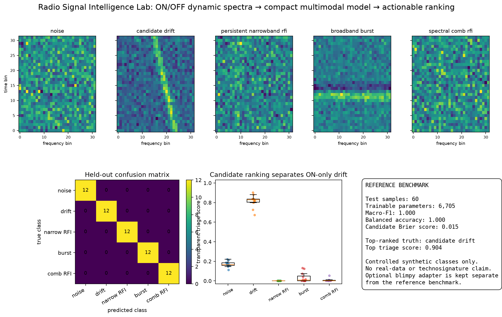

# radio-signal-intelligence-lab

[](https://github.com/pkd-45/radio-signal-intelligence-lab/actions/workflows/tests.yml)

**A compact multimodal AI benchmark for radio technosignature candidate triage.**

This independent portfolio project demonstrates how paired ON/OFF time-frequency data can be turned into a balanced, provenance-tracked dataset, a small purpose-built PyTorch model, and an actionable candidate ranking. It was designed around the technical requirements of the Oxford Intelligence Engineer role in Breakthrough Listen.

It is **not Breakthrough Listen production software**, does not bundle Breakthrough Listen data, and does not claim a real technosignature result.

## Why this is different from my existing radio repositories

- [`ml-radio-recon`](https://github.com/pkd-45/ml-radio-recon) addresses interferometric image reconstruction with a U-Net/Transformer and data-consistency anomaly checks.
- [`radio-pipeline-control-lab`](https://github.com/pkd-45/radio-pipeline-control-lab) addresses reliable execution, integrity, telemetry, restart/resume and scheduler planning.
- [`dsa-hi-survey-ops`](https://github.com/pkd-45/dsa-hi-survey-ops) addresses spectral planning, RFI-aware survey choices and science-product validation.
- This repository addresses **signal intelligence**: balanced ON/OFF dynamic-spectrum data, compact multimodal classification, model export and transparent candidate prioritisation.

## Pipeline

```text
synthetic or blimpy-loaded ON/OFF waterfalls
                    |
                    v
normalised 32x32 reference patches + six transparent metadata features
                    |
                    v
balanced manifest + group-safe train/validation/test splits
                    |
                    v
small multimodal CNN (<30k trainable parameters)
                    |
                    v
TorchScript model + confusion matrix + calibration metric
                    |
                    v
candidate_ranking.csv with transparent triage explanations
```

## Signal classes

1. noise;
2. ON-only drifting narrowband candidate;
3. persistent narrowband RFI present in ON and OFF;
4. broadband burst/transient-like contamination;
5. spectral-comb RFI.

The benchmark deliberately includes nuisance classes that can look visually salient while failing ON/OFF or occupancy tests.

## Quick start on macOS

Use Python 3.11–3.13. PyTorch wheels may not yet be available for every Python 3.14 environment.

```bash
chmod +x run_tests_macos.sh
./run_tests_macos.sh
```

Or manually:

```bash
python3.12 -m venv .venv
source .venv/bin/activate
python -m pip install -e '.[dev]'
pytest -q
radio-intel-lab demo --config configs/demo.json
```

## Reference output

The demo writes:

- `dataset.npz` and `manifest.csv`;
- `dataset_summary.json`;
- `tiny_multimodal_cnn.pt` and `tiny_multimodal_cnn_scripted.pt`;
- `model_card.md` and `training_history.json`;
- `test_metrics.json`;
- `candidate_ranking.csv`;
- `radio_signal_intelligence_summary.png`;
- optional `candidate_review_brief.md`, generated without calling an external API.

The shipped controlled reference run uses 400 balanced synthetic samples (80 per class), holds out 60 samples by group, and trains a 6,705-parameter model. It reaches macro-F1 and balanced accuracy of 1.000 with a candidate-class Brier score of 0.014. These perfect class-separation numbers reflect deliberately distinct synthetic morphologies and are a software-validation result, not evidence of performance on telescope data.



## Optional bounded LLM briefing

The role also asks for familiarity with commercial LLMs. This repository keeps that use narrow and auditable:

```bash
radio-intel-lab brief results/reference/candidate_ranking.csv \
  --output results/reference/candidate_review_brief.md
```

The command does not call an API. It creates a structured brief that tells an LLM to preserve scores, avoid discovery claims, and suggest only human-review questions. This demonstrates how LLMs can assist documentation without becoming the scientific decision-maker.

## Optional Breakthrough Listen data adapter

Install the optional I/O dependencies:

```bash
python -m pip install -e '.[bl]'
```

`radio_signal_intelligence.blimpy_adapter.load_waterfall` reads `.fil` or `.h5` products through `blimpy`, and `tile_pair` converts matching ON/OFF arrays into model-sized patches. Real-data evaluation should name, archive and cite the exact public input; it is intentionally separate from the synthetic reference benchmark.

## Model design

The model sees two image channels (ON and OFF waterfalls) and six interpretable metadata features. A three-layer CNN encodes the images; a small MLP encodes the metadata; the branches are fused for five-way classification. The exported TorchScript model is suitable for reproducible inference without the training harness.

The learned candidate probability is kept separate from a transparent ranking rule that rewards ON dominance and coherent drift while penalising broad occupancy. That score is a workflow triage aid, not a probability of extraterrestrial origin.

## Validation principles

- exact class balance;
- group-safe splits to avoid augmented-sibling leakage;
- macro-F1 and balanced accuracy rather than raw accuracy alone;
- candidate-class Brier score;
- explicit model-size limit;
- deterministic seeds and machine-readable outputs;
- honest separation of synthetic benchmarks from real-data claims.

See [`ROLE_MAPPING.md`](ROLE_MAPPING.md) and [`VALIDATION.md`](VALIDATION.md).

## Limitations

The signal morphologies and noise are intentionally compact. There is no telescope-specific bandpass, polarization, beamforming, dedoppler search, raw-voltage processing or measured RFI environment. A production path would benchmark against official pipelines, use named public ON/OFF cadences, include site- and receiver-aware metadata, and compare compact discriminative models with anomaly-detection and normalising-flow approaches.

## Author

Pratyush Kumar Das — PhD candidate in astrophysics, The University of Queensland  
ORCID: 0000-0002-4326-8598
